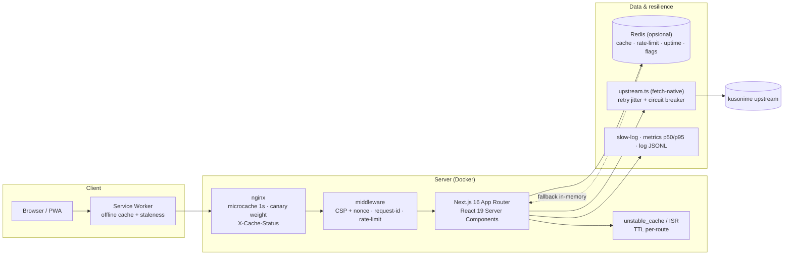

# Arsitektur

## Alur request

1. **nginx** — microcache 1 detik untuk HTML (burst absorber, header
   `X-Cache-Status`), `/api/*` selalu langsung. Canary memakai weighted upstream
   (`scripts/canary.sh`).
2. **middleware** — CSP + nonce (report-only default, enforce via
   `CSP_ENFORCE=1`), request-id, rate-limit per IP.
3. **Route handler / Server Component** — data dari cache tier (`Redis` atau
   in-memory, ADR 0001–0002) atau upstream `fetch` (ADR 0007).
4. **Service Worker** — shell offline + halaman tersimpan; hanya diregistrasi
   di origin produksi.

## Aturan data

- Katalog/pencarian/genre/musim: **tanpa HTTP cache**, selalu melalui cache
  tier bersama agar lintas-instance konsisten.
- Detail anime: `unstable_cache` + TTL 15 menit.
- API publik: `s-maxage` + `stale-while-revalidate` per route.
- Redis mati → semua fitur turun ke fallback in-memory dengan aman
  (`tests/chaos.test.ts` menjaga kontrak ini).

## Resiliensi upstream

Exponential backoff + jitter, circuit breaker bersama
(`UPSTREAM_CIRCUIT_KEY`), rate limit mengetat ×4 saat circuit terbuka, dan
penyajian data stale alih-alih error bila memungkinkan.

## Observability

Log JSONL (`logJson`) dengan redaksi token, slow-request ring buffer
(`/api/admin/slow`), metrik p50/p95 (`/api/metrics`), rollup uptime harian
(`/status`, `/api/admin/uptime`), alert webhook opsional
(`scripts/alert.mjs`).

## Deploy & rilis

`push main` → build image GHCR (`sha-xxxxxxx`) → `deploy.sh` health-gate +
auto-rollback → smoke e2e → warm cache. Canary bertahap tersedia
(`canary.sh start/watch/promote/abort`). Rilis: tag `v*` → GitHub Release;
bump semver otomatis via `scripts/version-bump.mjs`. Detail: `RUNBOOK.md`.

## Dokumen terkait

- `docs/adr/` — 10 keputusan arsitektur bernomor.
- `docs/env.md` — matriks env.
- `docs/dependencies.md` — kebijakan dependensi.
- `docs/api-quickstart.md` — resep API.
- `RUNBOOK.md` — operasi, rollback, backup, incident.
